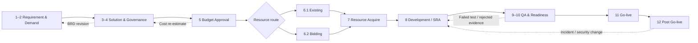

# 02 — As-Is Project Delivery: 12 Stages / 7 Workstreams

> Stage names and counts below follow `Improvement Process.xlsx`. 6.1 and 6.2 are **alternative** resource paths; counts represent catalog entries and are **not additive within a single project's executed route**.

## Layer 1 → Layer 2 mapping

| Workstream (7 categories; presentation grouping) | Stage IDs |
|---|---|
| 1. Requirement & Demand | 1–2 |
| 2. Solution & Governance | 3–4 |
| 3. Budget & Resource | 5, 6.1 **OR** 6.2, 7 |
| 4. Development | 8 |
| 5. Quality & Readiness | 9–10 |
| 6. Go-live | 11 |
| 7. Post Go-live Support | 12 |

## Layer 3 — Evidence by source Stage

`Loop flags` means **number of catalog rows marked `Y`**, not the count of repeated executions.

| Stage | Source stage title | Catalog items | Loop=Y | Example Tower work / deliverables |
|---|---|---:|---:|---|
| 1 | Approval Requirement | 12 | 9 | IT assessment; BRD; IT requirement; feasibility/cost estimate |
| 2 | Demand Governance | 8 | 8 | Revise BRD; RFI; project update; detailed requirement; SOW |
| 3 | Demand Prioritization | 1 | 1 | Coordinate BRD sign-off |
| 4 | Approval Architecture | 14 | 13 | RFI/RFP; POC; technical impact/assessment; ARB submission |
| 5 | Approval Budget | 5 | 3 | SCB/finance feasibility slides; approval flow |
| 6.1 | Resource Allocate (Existing) | 9 | 9 | HR request; HR eMemo; budget approval; RVM / OVMS |
| 6.2 | Resource Acquire (Bidding) | 12 | 12 | HR request; vendor sourcing; resource bidding docs |
| 7 | Resource Acquire (Bidding) | 7 | 7 | Vendor interview/deck; evaluation; procurement handoff |
| 8 | Project Development (SDLC) | **100** | **87** | Project setup; 13 infrastructure User Request Forms; source code; integration; **SRA** evidence / readiness |
| 9 | Quality Approval | 9 | 0 recorded | Source readiness, E2E/UAT test evidence, code scan (loop info not captured) |
| 10 | Technical Readiness Approval | 8 | 7 | Final architecture slides, runbook, WR/WI, audit readiness |
| 11 | Go-live and Monitoring | 8 | 0 recorded | Deploy standby; post-production testing; 1st-tier/day-2 support; OJT; closure |
| 12 | After Go-live Support | 6 | 0 recorded | Incident/security/infra fixes; impact assessment; redeploy/test support |

Total **199 catalog items** / **156 flagged `Loop=Y`** (the table includes both 6.1 and 6.2).

**Missing `Loop` data in stages 9, 11 and 12 ≠ zero rework.**

## Key rework mechanisms to visualize
- **BRD/Requirement:** revisions and multiple sign-offs across stages 1–3; a changed requirement can return to BRD work
- **Budget/Cost:** rejected or revised budget can require cost-estimate revision (upstream solution/architecture/cost work)
- **Change during SDLC:** changing requirements or cross-node impacts can trigger impact review and replan
- **Readiness / SRA:** rejected evidence or missing readiness may require rework and re-submission (stage 8 ↔ approval gate)
- **Test defect:** failed tests → fix and re-test
- **Post go-live:** production defects, security or infrastructure changes may require assessment/fix/test/redeployment

These paths are **illustrative relationships based on source steps + confirmed interviews**, not measured frequencies. Do not draw ladders implying an authorized fast-track unless confirmed.

## Architecture of the presentation

> Relationship flow is explanatory; detailed gating/exceptions require owner confirmation.
